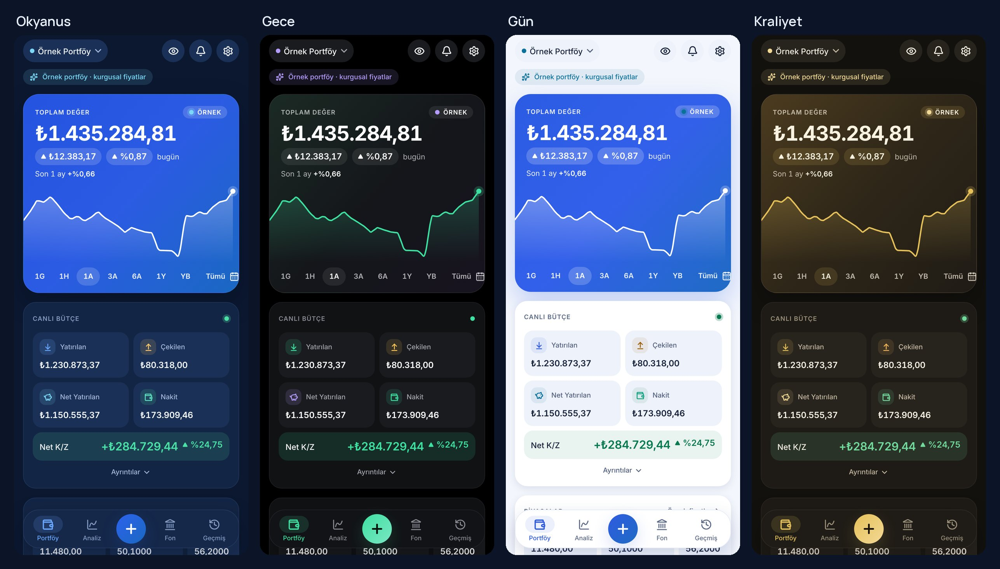

# Yatırım Takip

BIST, ABD borsaları ve kripto paraları tek yerde takip eden, profesyonel yatırım ölçülerini
(TWR, XIRR, Alpha, risk) kişisel portföye uygulayan, tamamen telefonda çalışan portföy takip
uygulaması.

> **Durum:** Faz 1–8 tamamlandı: tasarım, hesaplama motoru, veritabanı, piyasa verisi, ana
> ekran, işlem ekranları, geçmiş, hesap özeti. Kendi alış, satış, temettü ve bölünmelerini girip BIST, ABD ve kripto
> varlıklarını gerçek fiyatlarla takip edebilirsin; kripto fiyatları anlık akar. Sıradaki adım:
> Faz 9 (Analiz). Ayrıntılar: [yol haritası](docs/04-YOL-HARITASI.md),
> test raporları: [Faz 2](docs/test-raporu/faz2-hesaplama-motoru.md),
> [Faz 3](docs/test-raporu/faz3-veritabani.md), [Faz 4](docs/test-raporu/faz4-piyasa-verisi.md),
> [Faz 5](docs/test-raporu/faz5-ana-ekran.md), [Faz 6](docs/test-raporu/faz6-islem-ekranlari.md), [Faz 7](docs/test-raporu/faz7-gecmis.md), [Faz 8](docs/test-raporu/faz8-hesabim.md).



## Dokümanlar

| # | Doküman | İçerik |
|---|---|---|
| 1 | [Proje Dokümanı](docs/01-PROJE-DOKUMANI.md) | Vizyon, rakip analizi, özellikler, ekranlar, grafik, temalar, kararlar |
| 2 | [Hesaplama Motoru](docs/02-HESAPLAMA-MOTORU.md) | Maliyet, K/Z, TWR, XIRR, risk ve "Ya Olsaydı?" formülleri, örnek hesaplar |
| 3 | [Teknik Mimari](docs/03-TEKNIK-MIMARI.md) | Expo / React Native, klasör yapısı, veri modeli, piyasa veri kaynakları |
| 4 | [Yol Haritası](docs/04-YOL-HARITASI.md) | Fazlar ve bitiş kriterleri |
| — | [Önizleme görselleri](docs/onizleme/) | Her fazın ekranları |

## Öne Çıkanlar

- **Ekranlar:**
  - Canlı bakiye ve canlı bütçe (yatırılan / çekilen / net)
  - 1G–1Y ve özel aralıklı bakiye grafiği
- **İşlemler:**
  - Manuel alış/satış girişi
  - Sağa/sola kaydırarak düzenle, al, sat, sil
- **Fon (Hesabım):** Toplam varlık, maliyet, kâr/zarar ve iki ayrı tuşla **Varlık** / **Maliyet** görünümü
- **Analiz:**
  - Performans Karnesi: Bugün, TWR, XIRR, Alpha
  - Beta, Sharpe, Sortino, volatilite, maksimum düşüş
  - Dokun-kaydır karşılaştırma grafiği
- **Ya Olsaydı?:**
  - Aynı tutarları aynı tarihlerde şunlara yatırsaydınız ne olurdu: BIST 100, BIST 30, altın, gümüş, S&P 500, Russell 2000, Nasdaq, Bitcoin, Dolar/TL, Euro/TL, TÜFE, mevduat
  - Lig tablosu ve dokun-kaydır grafikle karşılaştırma
- **Temalar:** 4 tema: Okyanus (mavi), Gece, Gün, Kraliyet. Hepsi WCAG AA kontrast testinden geçer
- **Gizlilik:** Veriler telefonda kalır (SQLite), gizlilik modu, parmak izi kilidi (Faz 10)
- **Yedekleme:** Tek dosya JSON yedek, paylaş menüsüyle Drive'a veya e-postaya; denetimli geri yükleme
- **Piyasa verisi:** Yahoo, Binance, CoinGecko, İş Yatırım ve TCMB; anahtar gerekmez, istekler doğrudan telefondan gider. Kaynak hata verirse yedeğe geçer

## Geliştirme

Gereksinim: Node.js 22.

```bash
npm install
npm start          # Expo Go ile QR kodu okutarak telefonda aç
npm run android    # Bağlı Android cihazda / emülatörde aç
npm run web        # Tarayıcıda önizleme
npm run check      # Tip kontrolü + lint + testler
npm run test:live  # Piyasa kaynaklarını gerçek isteklerle dener (internet gerekir)
```

### Android telefonda kurulum

**APK'yı GitHub'dan indirin (bilgisayar gerekmez):**

1. Telefonda şu sayfayı açın: <https://github.com/yapaysaman5-coder/Yat-r-mTakip/releases/tag/android-latest>
2. `YatirimTakip-<numara>.apk` dosyasına dokunup indirin (≈ 40 MB). Doğrudan bağlantı: <https://github.com/yapaysaman5-coder/Yat-r-mTakip/releases/download/android-latest/YatirimTakip-6.apk> (numara her derlemede artar, güncel dosya için sayfayı kullanın).
3. İndirilen dosyayı açın. Android "bilinmeyen uygulamaları yükle" izni isterse tarayıcınıza izin verin, sonra **Yükle**'ye dokunun.
4. Yeni bir sürüm çıktığında aynı sayfadan indirip kurun. Eski sürümün üzerine güncelleme olarak kurulur.

APK 64-bit ARM (arm64) telefonlar içindir, son yıllardaki tüm Android telefonlar böyledir. İmza şimdilik
kişisel kurulum için yeterli olan geliştirme anahtarıyla yapılır. Play Store için ayrı imza Faz 11'de eklenecek.

APK, uygulama kodu her değiştiğinde GitHub Actions ile otomatik derlenir (`.github/workflows/android-apk.yml`).

**Geliştirme için diğer yollar:**

1. **Expo Go ile:**
   - Telefona Play Store'dan **Expo Go** uygulamasını kurun.
   - Bilgisayarda bu depoyu açıp `npm install` ve `npm start` çalıştırın.
   - Çıkan QR kodu Expo Go ile okutun.
2. **Bağlı cihaz:** `npm run android` (Android SDK kurulu bir bilgisayar gerekir).

## Yasal Uyarı

Bu uygulama kişisel takip amaçlıdır. Gösterilen bilgiler yatırım tavsiyesi değildir.
