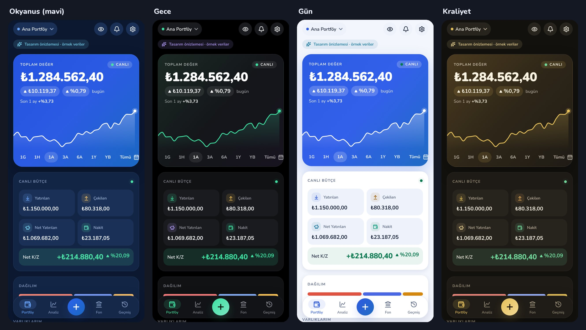

# Yatırım Takip

BIST, ABD borsaları ve kripto paraları tek yerde takip eden, portföyü bir yatırım fonu gibi
raporlayan, tamamen telefonda çalışan profesyonel portföy takip uygulaması.

> **Durum:** Faz 1 tamamlandı. Proje iskeleti, 4 tema, tasarım sistemi ve ekran önizlemeleri hazır.
> Sıradaki adım: Faz 2 (hesaplama motoru). Ayrıntılar: [yol haritası](docs/04-YOL-HARITASI.md).



## Dokümanlar

| # | Doküman | İçerik |
|---|---|---|
| 1 | [Proje Dokümanı](docs/01-PROJE-DOKUMANI.md) | Vizyon, rakip analizi, özellikler, ekranlar, grafik, temalar, kararlar |
| 2 | [Hesaplama Motoru](docs/02-HESAPLAMA-MOTORU.md) | Maliyet, K/Z, TWR, XIRR, risk ve "Ya Olsaydı?" formülleri, örnek hesaplar |
| 3 | [Teknik Mimari](docs/03-TEKNIK-MIMARI.md) | Expo / React Native, klasör yapısı, veri modeli, piyasa veri kaynakları |
| 4 | [Yol Haritası](docs/04-YOL-HARITASI.md) | Fazlar ve bitiş kriterleri |
| — | [Önizleme görselleri](docs/onizleme/faz1/) | Faz 1 ekranları, 4 tema |

## Öne Çıkanlar

- **Ekranlar:**
  - Canlı bakiye ve canlı bütçe (yatırılan / çekilen / net)
  - 1G–1Y ve özel aralıklı bakiye grafiği
- **İşlemler:**
  - Manuel alış/satış girişi
  - Sağa/sola kaydırarak düzenle, al, sat, sil
- **Fon (Hesabım):** Pay değeri ve iki ayrı tuşla **Varlık** / **Maliyet** görünümü
- **Ya Olsaydı?:**
  - Aynı tutarları aynı tarihlerde şunlara yatırsaydınız ne olurdu: BIST 100, BIST 30, altın, gümüş, S&P 500, Russell 2000, Nasdaq, Bitcoin, Dolar/TL, Euro/TL, TÜFE, mevduat
  - Fon düzeyinde metriklerle karşılaştırma
- **Temalar:** 4 tema: Okyanus (mavi), Gece, Gün, Kraliyet. Hepsi WCAG AA kontrast testinden geçer
- **Gizlilik:** Veriler telefonda kalır, gizlilik modu, parmak izi kilidi (Faz 10)

## Geliştirme

Gereksinim: Node.js 22.

```bash
npm install
npm start          # Expo Go ile QR kodu okutarak telefonda aç
npm run android    # Bağlı Android cihazda / emülatörde aç
npm run web        # Tarayıcıda önizleme
npm run check      # Tip kontrolü + lint + testler
```

### Android telefonda deneme

1. **Expo Go ile:**
   - Telefona Play Store'dan **Expo Go** uygulamasını kurun.
   - Bilgisayarda bu depoyu açıp `npm install` ve `npm start` çalıştırın.
   - Çıkan QR kodu Expo Go ile okutun.
2. **APK ile (bilgisayarsız):** Expo hesabıyla bulutta derlenen kurulabilir APK. Bu yol yayın hazırlığında (Faz 11) kurulacak, istenirse daha önce de hazırlanabilir.

## Yasal Uyarı

Bu uygulama kişisel takip amaçlıdır. Gösterilen bilgiler yatırım tavsiyesi değildir.
