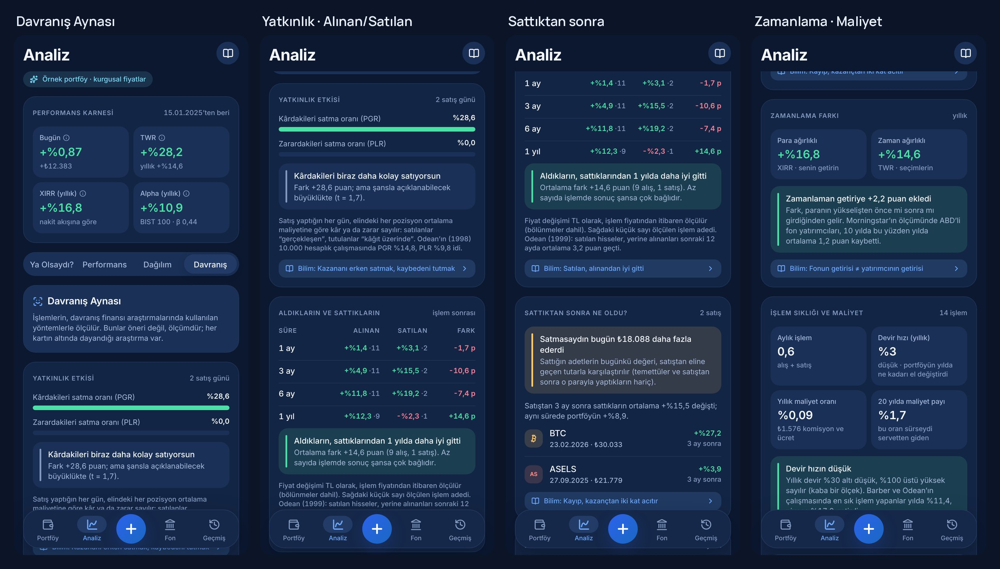
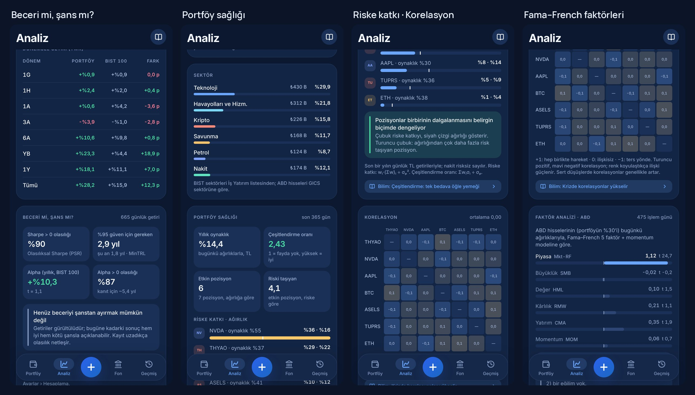
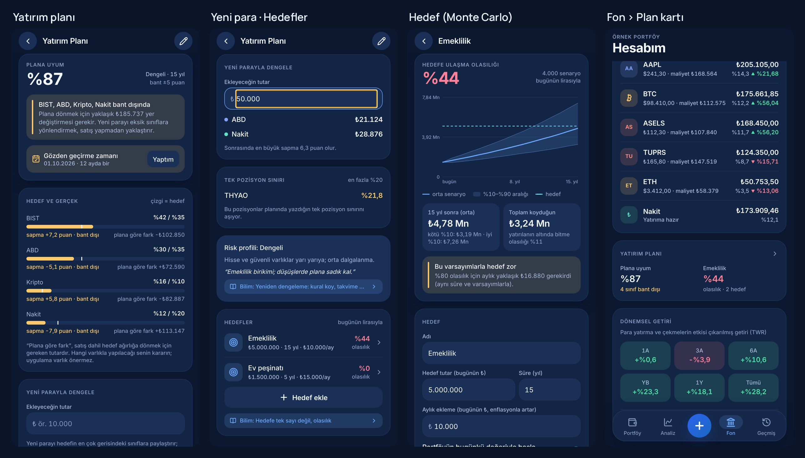
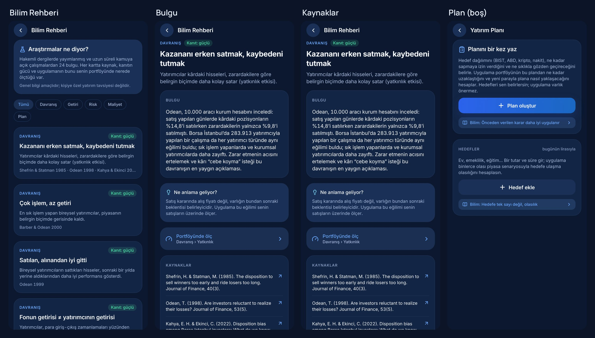

# Bilim Paketi: Test Raporu

**Tarih:** 11 Kasım 2026 · **Sürüm:** 0.11.0

Kullanıcının isteği: “Dünyada bilimsel olarak test edilmiş ve doğru kabul edilmiş yatırım
bilgilerini uygulamaya üst düzey profesyonel ekleyelim.” A–G seçeneklerinin tamamı istendi.
Formüller [02-HESAPLAMA-MOTORU.md §16](../02-HESAPLAMA-MOTORU.md#16-bilim-paketi-11-kasım-2026)
bölümünde, ekranlar [01-PROJE-DOKUMANI.md §6.12–6.13](../01-PROJE-DOKUMANI.md) bölümlerinde.

## 1. Sonuç

| Kontrol | Sonuç |
|---|---|
| Birim ve senaryo testleri | **427 geçti**, 5 atlandı (yalnızca canlı modda çalışanlar) |
| Kapsam (`src/data`, `src/domain`) | Satır %97,5 · dal %83,9 · fonksiyon %96,3; eşikler tutuyor |
| Tip denetimi, lint, biçim | Temiz |
| Canlı kaynak: Fama–French indirme | ✅ 247 işlem günü, 07.10.2025 – 30.09.2026 |
| Web önizleme | 22 ekran görüntüsü, sayfa hatası yok |

## 2. Yeni Testler

### İstatistik çekirdeği (`src/domain/__tests__/stats.test.ts`, 7 test)

Ortalama, varyans, kovaryans, korelasyon, çarpıklık, basıklık, normal dağılım (Φ ve tersi),
EKK regresyonu (katsayı, standart hata, t, R²), matris tersi, tohumlu rastgele sayı ve yüzdelik
dilim. Ders kitabı örnekleriyle karşılaştırıldı.

### Davranış Aynası (`src/data/__tests__/behavior.test.ts`, 5 test)

Elle hesaplanan iki hisseli senaryo:

| Tarih | A | B | İşlem |
|---|---|---|---|
| 05.01 | 100 | 100 | 100 A + 100 B alış |
| 02.02 | 120 | 80 | 50 A satış (gerçekleşen kâr; B kâğıt üzerinde zarar) |
| 02.03 | 130 | 70 | 100 B satış (gerçekleşen zarar; A kâğıt üzerinde kâr) |
| 01.05 | 150 | 90 | — |

- **Yatkınlık:** 2 satış günü, RK = 1, KZ = 1, RZ = 1, KK = 1, PGR = PLR = 0,5, fark 0. Yeterli
  gözlem yok (< 5).
- **Sattıktan sonra:** A satışından 30 gün sonra 130/120 − 1, 91 gün sonra 150/120 − 1; B için
  30 gün sonra 0, 91 gün sonra 90/70 − 1. Bugünkü değer farkı 1.500 + 2.000 = ₺3.500.
- **Zamanlama farkı:** MWR − TWR, bir yıldan kısa geçmişte dönem getirileriyle.
- **İşlem sıklığı:** 4 işlem; devir = 13.000 ÷ ortalama değer ÷ yıl → “yüksek”; komisyonsuz
  maliyet oranı 0.
- Örnek portföyde uçtan uca: satış günü var, maliyet oranı > 0, 20 yıllık pay > yıllık oran.

### Bilim görünümleri (`src/data/__tests__/science.test.ts`, 17 test)

| Konu | Test | Beklenen |
|---|---|---|
| Beceri | 20 günden az getiri | “veri az” |
| Beceri | Günlük %0,2 sabit alpha + gürültü (500 gün) | yıllık alpha ≈ 0,73, t > 5, olasılık > %99 |
| Beceri | PSR ile MinTRL tutarlılığı | (MinTRL − 1)/(n − 1) = (z₉₅ / z_PSR)², 6 basamak |
| Beceri | Saf gürültü / sürekli zarar | |t| < 3 / “olumsuz”, MinTRL yok |
| Beceri | Bailey ve López de Prado formülü | SR 0,1, n 253, normal → PSR ≈ 0,9434 |
| Sağlık | İlişkisiz iki varlık (+−+− ve ++−−) | korelasyon 0, çeşitlendirme oranı √2, riske katkı ½–½, etkin pozisyon 2 |
| Sağlık | Nakit yarı yarıya | σₚ = σ·√(0,25² + 0,25²) |
| Sağlık | Birlikte hareket eden iki varlık (biri 2 kat) | korelasyon 1, oran 1, büyük olan riskin ⅔'ü |
| Sağlık | 30 günden az ortak geçmiş | “yeterli değil”, gün sayısı raporlanır |
| Faktör | Gerçek kütüphane dosyaları (zip) | başlık `Mkt-RF, SMB, HML, RMW, CMA, RF`, yüzde → ondalık, son gün 30.09.2026 |
| Faktör | Zip olmayan dosya | `MarketError` |
| Faktör | Bilinen yüklemelerle üretilmiş getiri (1,2 / 0,5 / −0,4 + gürültü) | betalar 0,1 hassasiyetle bulunur, üçü belirgin, MOM ≈ 0, R² > 0,9 |
| Faktör | İndirme servisi | iki dosya bir kez indirilir; 3 gün sonra “taze”; hata kaydedilir, eski veri korunur; DB'den okunan = doğrudan ayrıştırılan |
| Plan | %50/%30/%20 portföy, hedef %40/%40/%10/%10 | sapmalar ±10 puan, uyum %80, hedefe dönüş ±₺10, sınırı aşanlar A ve C, gözden geçirme 01.01.2027 |
| Plan | ₺20 yeni para | açıklar 18 : 12 → ABD ₺12, nakit ₺8; sonraki en büyük sapma 6,7 puan |
| Hedef | Oynaklık 0 | bitiş = 1000 × 1,05¹⁰; %80 için aylık tutar annüiteden tam bulunur |
| Hedef | Tohumlu tekrarlanabilirlik, riskli/güvenli karşılaştırma | aynı girdi aynı sonuç; riskli profilin aralığı daha geniş |
| Hedef | 20.000 senaryo, 1 yıl | medyan = (1+μ)/√(1+σ²/(1+μ)²), 2 basamak |
| Uçtan uca | Örnek portföy | beceri, sağlık (riske katkı toplamı 1), faktör (piyasa betası belirgin) |

### Bilim Rehberi (`src/science/__tests__/guide.test.ts`, 5 test)

- 24 bulgu, benzersiz kimlik, her birinde kaynak (yazar ve yıl ya da veri seti) ve `https` bağlantı.
- “Portföyünde ölç” bağlantıları yalnızca var olan ekranlara gider (`/plan`,
  `/(tabs)/analiz?bolum=…`).
- Uygulamadaki her `<ScienceLink id="…">` bir rehber kartına karşılık gelir (kaynak kod taranır).
- Metinlerde kişiye özel al/sat yönlendirmesi yok.
- Kısa atıf: “Barber & Odean 2000”, “Dimson vd. 2025”, “Bailey & López de Prado 2012”.

### Güncellenen test

`sync.test.ts`: elde tutulan varlıkların fiyatları artık ilk kayıttan önceye de iner (ABD hissesi
1100 gün). Beklentiler buna göre güncellendi; daha eski bir kayıt eklenince yalnızca eksik eski
günlerin indirildiği hâlâ doğrulanıyor.

## 3. Kaynak Doğrulaması

Rehberde ve kartlarda yazan her sayı kaynağıyla karşılaştırıldı. Doğrulanamayan sayı yazılmadı.

| Sayı | Kaynak | Durum |
|---|---|---|
| PGR %14,8, PLR %9,8; 10.000 hesap | Odean (1998), Journal of Finance 53(5) | ✅ |
| Satılanlar alınanları 12 ayda 3,2 puan, 24 ayda 3,6 puan geçti | Odean (1999), AER 89(5); Berkeley Haas özeti | ✅ (3,3 değil 3,2) |
| 283.913 Borsa İstanbul yatırımcısı; tüm türlerde yatkınlık, sık işlem yapanlarda daha az | Kahya ve Ekinci (2022), JBEF 35 | ✅ |
| En aktif grup %11,4, piyasa %17,9; 66.465 hane, 1991–1996 | Barber ve Odean (2000), JF 55(2) | ✅ |
| Erkekler %45 fazla işlem; net getiri kaybı 2,65 / 1,72 puan | Barber ve Odean (2001), QJE 116(1) | ✅ |
| Yatırımcı %7,0, fon %8,2; fark 1,2 puan (10 yıl, 2024 sonu) | Morningstar Mind the Gap 2025 | ✅ |
| ~%90 aktif büyük şirket fonu 15 yılda S&P 500'ün gerisinde | SPIVA U.S. Year-End 2024 | ✅ |
| Net servetin tamamı hisselerin ~%4'ünden; yarıdan fazlası bonodan az | Bessembinder (2018), JFE 129(3) | ✅ |
| Dünya hisseleri reel %5,2, tahvil %1,7, bono %0,5 (1900–2024); bu yüzyıl %3,5 | UBS Global Investment Returns Yearbook 2025 | ✅ |
| Toplu yatırım ~%68 vakada kademeliden iyi | Vanguard (2023) | ✅ |
| Yılda 1–2 kontrol, ~5 puan bant | Vanguard, Best practices for portfolio rebalancing | ✅ |
| Kayıp katsayısı ≈ 2,25 | Tversky ve Kahneman (1992) | ✅ |
| Tasarruf oranı 40 ayda %3,5 → %13,6 | Thaler ve Benartzi (2004), JPE 112(S1) | ✅ |
| Aktif yatırım maliyeti piyasa değerinin ~%0,67'si (1980–2006) | French (2008), JF 63(4) | ✅ |
| Yıllık %1 maliyet 30 yılda ~%26 | Matematik: 1 − 0,99³⁰ | ✅ |
| Ev yanlılığı yüzdeleri | French ve Poterba (1991) | ⚠️ Yüzde yazılmadı, yalnızca bulgu |

## 4. Önizleme

## 5. Bilinen Sınırlar

- **Örnek portföy:** Fiyatlar kurgusal ve birbirinden bağımsız üretildiği için korelasyonlar
  0'a yakın, çeşitlendirme oranı yüksek çıkar. Faktörler de kurgusaldır (kartta yazar). Gerçek
  portföyde bunlar gerçek fiyatlardan hesaplanır.
- **Faktör verisi** aylık güncellenir: son 1–2 ay regresyona girmez.
- **Az veri:** Beceri ve davranış ölçümleri kısa geçmişte geniş belirsizlik taşır. Kartlar bunu
  “henüz ayırmak mümkün değil” ya da “yeterli gözlem yok” diye söyler.
- **Hedef planlama** vergi, komisyon ve kur farkını içermez. Varsayımlar kişinin seçimidir.
- **İlk açılışta indirme:** Uzun fiyat geçmişi (400 / 1100 gün) güncellemeden sonraki ilk
  açılışta bir kez indirilir; sonra yalnızca son günler yenilenir.

## 6. Telefonda Kontrol Listesi

- [ ] Analiz › Davranış: kartlar açılıyor, “Bilim:” bağlantıları rehbere gidiyor
- [ ] Analiz › Dağılım: Portföy sağlığı ve korelasyon (fiyat geçmişi inince), ABD hissesi varsa faktör analizi
- [ ] Bilim Rehberi: kaynak bağlantıları tarayıcıda açılıyor, “Portföyünde ölç” doğru bölümü açıyor
- [ ] Fon › Yatırım planı: plan oluştur, düzenle, “Bugünkü dağılım”, yeni para hesabı
- [ ] Hedef ekle / düzenle / sil; olasılık ve grafik girişle birlikte güncelleniyor
- [ ] Yedek al → geri yükle: plan ve hedefler geri geliyor
